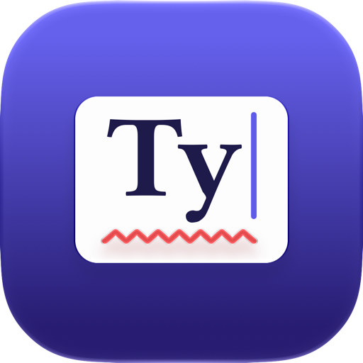
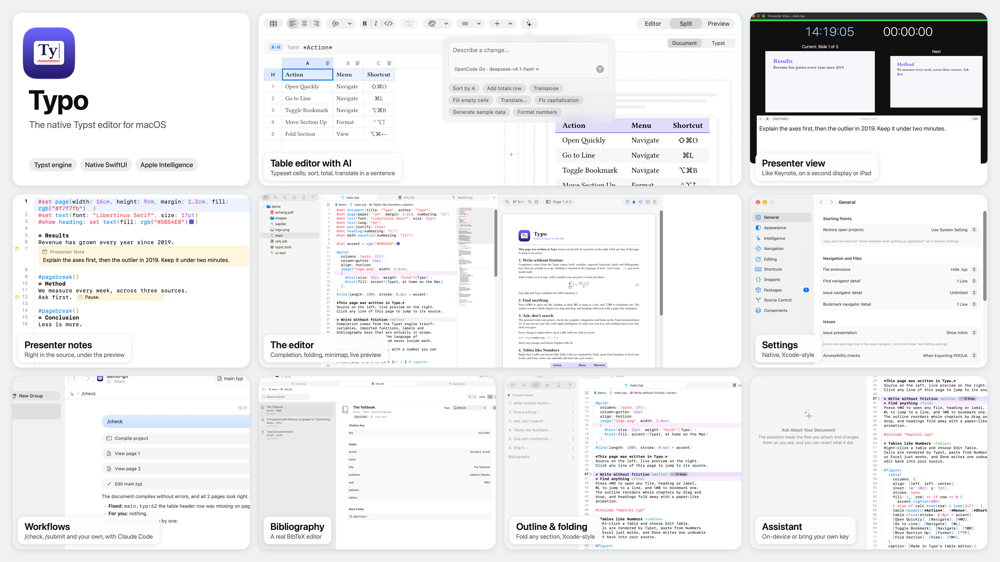

<p align="center"></p>

<h1 align="center">Typo</h1>
<p align="center">Typst, zu Hause auf dem Mac.</p>
<p align="center"><a href="README.md">English</a> · <b>Deutsch</b></p>

<p align="center"></p>

Typo ist ein nativer macOS-Editor für [Typst](https://typst.app), geschrieben in Swift und SwiftUI, mit dem echten Typst-Compiler. Website: [scholzdev.github.io/typo](https://scholzdev.github.io/typo/de/).

## Funktionen

- Live-Vorschau mit Klick zur Quelle, Vervollständigung aus der Typst-Engine, Rechtschreibprüfung in der Sprache des Dokuments
- Ein Tabelleneditor wie in einer Tabellenkalkulation mit KI-Hilfe, Falten wie in Xcode, Drag and Drop in der Gliederung, Lesezeichen, Open Quickly
- Ein BibTeX-Editor mit Suche nach DOI, arXiv und ISBN, Zotero-Sync und ein Browser für Pakete aus Typst Universe
- Ein optionaler Assistent: auf dem Gerät mit Apple Intelligence, mit deinem eigenen API-Schlüssel oder mit Claude Code über das Agent Client Protocol, mit Workflows wie `/check` und `/submit`
- Export als PDF (auch nur einzelne Seiten), PDF/A, PDF/UA-1, PNG und SVG, Drucken, Präsentationsmodus mit Referentenansicht

Die vollständige Liste steht in [FEATURES.md](FEATURES.md) (Englisch), und das [Handbuch](https://scholzdev.github.io/typo/guide/) (Englisch) zeigt, wie alles funktioniert.

Die Oberfläche von Typo ist im Moment nur auf Englisch. Die deutsche Übersetzung ist in Arbeit.

## Datenschutz

Typo sammelt keine Analyse- oder Nutzungsdaten und sendet nichts, bis du unter Settings › Intelligence einen Anbieter oder einen Agenten einrichtest.

- Apple Intelligence läuft auf deinem Mac, nichts verlässt ihn.
- Ein Anbieter, den du mit einem API-Schlüssel hinzufügst, bekommt deine Nachrichten, die Unterhaltung und die Dateien, die du anhängst oder lesen lässt. Der Schlüssel liegt in deinem Schlüsselbund.
- Ein Agent wie Claude Code läuft auf deinem Mac im Projektordner und sendet, was er liest, an seinen eigenen Anbieter, zu dessen Bedingungen.
- Unterhaltungen liegen auf deinem Mac und lassen sich jederzeit löschen.

## Voraussetzungen

Typo läuft unter macOS 27 auf einem Mac mit Apple-Chip. Zum Bauen brauchst du Xcode 27. Die Typst-Engine ist eine Rust-Bibliothek in `bridge/`, deshalb brauchst du zum Bauen auch Rust (`rustup`) und [XcodeGen](https://github.com/yonaskolb/XcodeGen).

## Installieren

Lade die neueste Version von [GitHub Releases](https://github.com/scholzdev/typo/releases/latest) und zieh Typo in den Programme-Ordner. Typo ist noch nicht von Apple beglaubigt (notarisiert), deshalb musst du den ersten Start einmal erlauben: Öffne Typo, wähle „Fertig“ und klicke dann unter Systemeinstellungen › Datenschutz & Sicherheit auf **Dennoch öffnen**. Oder führe `xattr -dr com.apple.quarantine /Applications/Typo.app` im Terminal aus.

## Bauen

```bash
./build.sh
```

Das baut die Typst-Bridge, wenn sie fehlt oder sich ihr Rust-Code geändert hat, erzeugt das Xcode-Projekt und legt die App unter `build/Typo.app` ab. Mit `--open` startet sie danach, mit `--debug` gibt es einen Debug-Build, `--test` lässt vorher die Pakettests laufen, und `--help` zeigt den Rest. Wenn du lieber in Xcode arbeitest, führe `./build.sh` einmal aus (oder `xcodegen generate`, wenn die Bridge schon gebaut ist) und öffne `Typo.xcodeproj`.

Der erste Bau der Bridge kompiliert Typst und dauert ein paar Minuten. `./release.sh <version>` baut eine Release-ZIP, signiert sie für Sparkle-Updates und trägt sie in `docs/appcast.xml` ein. Das Swift-Paket mit der Editor-Logik hat eigene Tests:

```bash
cd Packages/Typo && swift test
```

Wie du beitragen kannst, steht in [CONTRIBUTING.md](CONTRIBUTING.md) (Englisch).

## Lizenz

Typo ist für nichtkommerzielle Zwecke kostenlos, und der Quellcode ist offen lesbar, aber Typo ist **keine** Open-Source-Software im Sinne der OSI. Du darfst Typo bauen, ändern und selbst nutzen und Änderungen als Pull Request zurückschicken. Du darfst Typo oder veränderte Versionen nicht ohne Erlaubnis weitergeben oder kommerziell nutzen. Verbindlich ist die englische [LICENSE](LICENSE). Bestandteile von Dritten behalten ihre eigenen Lizenzen, aufgeführt in [App/Acknowledgements.txt](App/Acknowledgements.txt).

Typo steht in keiner Verbindung zur Typst GmbH.
