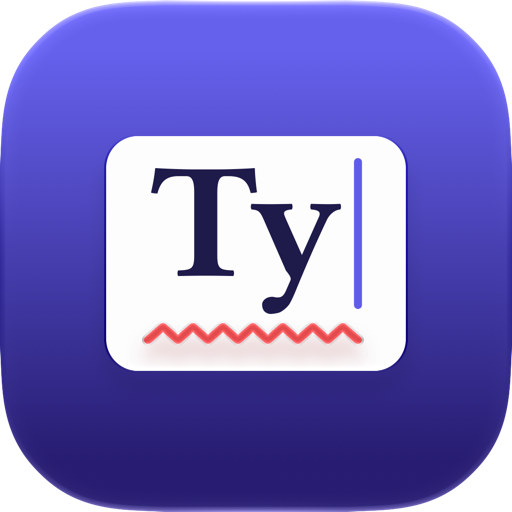
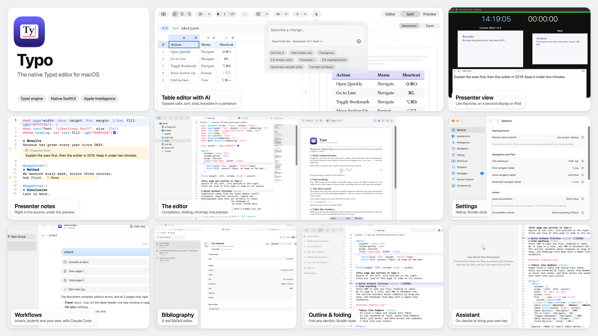

<p align="center"></p>

<h1 align="center">Typo</h1>
<p align="center">Typst, at home on the Mac.</p>

<p align="center"></p>

Typo is a native macOS editor for [Typst](https://typst.app), written in Swift and SwiftUI and running the real Typst compiler. Website: [scholzdev.github.io/typo](https://scholzdev.github.io/typo/).

## Features

- Live preview with click-to-source, completion from the Typst engine, spell checking in the document's language
- A spreadsheet-like table editor with AI assist, Xcode-style folding, outline drag and drop, bookmarks, Open Quickly
- A BibTeX editor with DOI, arXiv and ISBN lookup, a Typst Universe package browser
- An optional assistant: on-device with Apple Intelligence, with your own API key, or your own agent (Claude Code, Codex, Gemini CLI) through the Agent Client Protocol
- Export to PDF, PDF/A, PDF/UA-1, PNG and SVG, presentation mode with presenter notes

The full list is in [FEATURES.md](FEATURES.md).

## Privacy

Typo collects no analytics or usage data, and it sends nothing anywhere until you set up a model provider or an agent in Settings › Intelligence.

- Apple Intelligence runs on your Mac; nothing leaves it.
- A model provider you add with an API key receives your messages, the conversation and the files you attach or let it read. The key is kept in your Keychain.
- An agent (Claude Code, Codex, Gemini CLI and others) runs on your Mac in the project folder and sends what it reads to its own provider, under that provider's terms.
- Conversations are stored on your Mac and can be deleted at any time.

## Requirements

macOS 27 and Xcode 27 to build. The Typst engine is a Rust library in `bridge/`, so building also needs a Rust toolchain (`rustup`) and [XcodeGen](https://github.com/yonaskolb/XcodeGen).

## Installing

Download the latest release from [GitHub Releases](https://github.com/scholzdev/typo/releases/latest) and move Typo to Applications. Typo isn't notarized by Apple yet, so the first launch needs your OK once: open it, choose Done, then click **Open Anyway** in System Settings › Privacy & Security. Or run `xattr -dr com.apple.quarantine /Applications/Typo.app`.

## Building

```bash
./build.sh
```

This builds the Typst bridge when it is missing or its Rust sources changed, generates the Xcode project and puts the app in `build/Typo.app`. Add `--open` to start it afterwards, `--debug` for a debug build, `--test` to run the package tests first, and `--help` for the rest. To work in Xcode instead, run `./build.sh` once (or `xcodegen generate` when the bridge is already built) and open `Typo.xcodeproj`.

The first bridge build compiles Typst, which takes a few minutes. `./release.sh <version>` builds a release zip, signs it for Sparkle updates and adds it to `docs/appcast.xml`. The Swift package with the editor logic has its own tests:

```bash
cd Packages/Typo && swift test
```

## License

Typo is free for noncommercial use and its source is open to read, but it is **not** open source in the OSI sense. You may build, change and use it for yourself, and send changes back as pull requests. You may not distribute it or changed versions of it, or use it commercially, without permission. See [LICENSE](LICENSE). Third-party parts keep their own licenses, listed in [App/Acknowledgements.txt](App/Acknowledgements.txt).

Typo is not affiliated with Typst GmbH.
